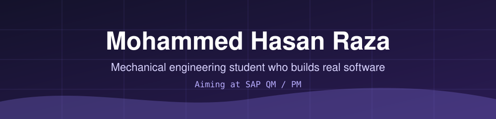

<p align="center">
  
</p>

<p align="center">
  
</p>

<p align="center"><em>"Necessity is the mother of invention."</em></p>

## Right now

2nd-year BTech Mechanical Engineering student at BSA Crescent Institute of Science and Technology, Chennai, aiming at SAP QM and PM roles.

```text
Finishing   Enderchest: final tests, real camera and printer checks
Aiming at   SAP Quality Management (QM) and Plant Maintenance (PM)
Planning    SAP certification in my 3rd year (not certified yet)
Way of work I decide what gets built and test it; AI coding tools help write it
```

## Where I focus

| Area | What it means in my projects |
|---|---|
| **Quality data at machine level** | My Arduino quality-check rig measures items against tolerance limits and logs pass or fail, so I can see how QC data is created before it reaches a system like SAP QM. |
| **Maintenance and quality ideas** | Enderchest takes ideas from SAP PM and QM (inspection planning, lifecycle, audit trail) and scales them down to one person's home. It is inspired by SAP. It is not SAP software. |
| **Software that works offline** | Enderchest, MAYDAY, GlobAI and Alpha Banana are all built to run on your own machine. |
| **Honest software** | A value read by OCR is confirmed by a person before it counts. Simulated parts are labelled as simulated. |

## Tools used in my projects

<p align="left">
  
</p>

## Selected work

| Project | What it is | Honest status |
|---|---|---|
| **[Enderchest](https://github.com/mohammedhasanraza007/Enderchest)** | Camera-driven personal inventory and maintenance app: local OCR, QR labels, "do I already own this?", inspections and verified backups. FastAPI, React, TypeScript, SQLite, Docker. Built with Claude Code as co-worker, as its README credits. | Runs on my PC and one second Windows 11 laptop. Final click-through, real camera and printer checks are still open. |
| **Arduino quality-check rig** | IR and ultrasonic sensors check an item against tolerance limits, a servo rejects failures, Python logs each reading to CSV, and Power BI shows the trends. | Working bench rig with a demo video on LinkedIn. Code not public. No conveyor or case yet. |
| **[Pakka Hisaab](https://github.com/mohammedhasanraza007/Pakka_Hissab-Prototype)** | Prototype of a shop checkout driven by typed or spoken commands in English, Hindi and Tamil, backed by real SQLite states. | Prototype. Data is synthetic and payments are simulated. No real money moves. |
| **[MAYDAY](https://github.com/mohammedhasanraza007/MAYDAY)** | Offline-first desktop agent that runs a local model on the CPU and works in an observe, act, verify loop, with an approval dialog for risky actions. PyQt6, Playwright. | Personal project. Speed depends on the CPU. |
| **[GlobAI](https://github.com/mohammedhasanraza007/GlobAI)** | Local desktop assistant combining document search (RAG), coding help and image generation. PyQt6, PyTorch, FAISS. | Personal project, Windows. |
| **[Alpha Banana](https://github.com/mohammedhasanraza007/Alpha-banana_v1)** | Simple Streamlit app for making images with Stable Diffusion on your own computer. | First version, Windows only. |

## How I got here

| When | What |
|---|---|
| Nov 2026 | Published Enderchest |
| Aug 2026 | Published Pakka Hisaab, a shop checkout prototype. Foundations in Heavy Industry Production certificate, L&T EduTech |
| May 2026 | Published GlobAI and MAYDAY |
| Apr 2026 | Published Alpha Banana, my first public repository |
| Late 2025 | Built the Arduino quality-check rig |
| Aug 2025 | Started BTech Mechanical Engineering at BSA Crescent (expected May 2029). Microsoft Excel course certificate, Udemy |

## What I hold to

- Nothing fake: if something cannot truly work, the software says so.
- A person confirms; the software proposes.
- Say what is finished and what is not.

## Contact

[LinkedIn](https://www.linkedin.com/in/mohammed-hasan-raza-507411385) · [Email](mailto:mohammedhasanraza0@gmail.com)
